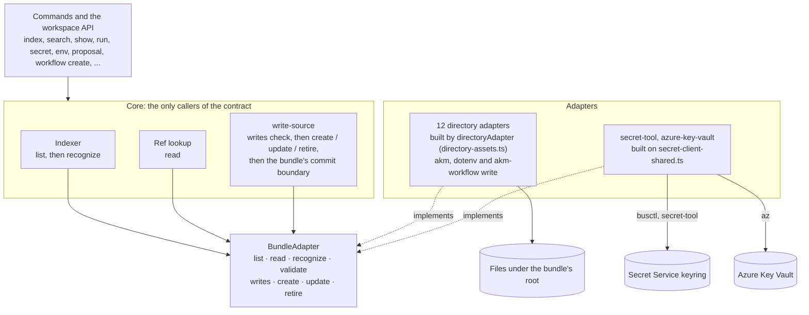

# Adapters

A **`BundleAdapter`** (`src/core/adapter/bundle-adapter.ts`) is the layer
through which the rest of akm works with a bundle's assets, whatever keeps
them. The adapter owns the mechanics of its bundles: how assets are listed,
read, described for the index, created, updated and retired, and how `akm
lint` validates them. Everything outside the adapter calls these members and
does not ask which adapter it has or how the bundle is stored. akm ships 14
built-in adapters: 12 read a directory, one per format in
[Supported Formats](../reference/supported-formats.md), and 2 read a secret
manager (an OS keyring, an Azure Key Vault). This page is the internals
reference; that page is the compatibility table.

For read-only native tool bundles, recognition is runtime translation, not
conversion: the adapter projects native files into AKM's index/runtime shapes
while the source file remains authoritative. AKM does not synchronize native
formats, maintain translated canonical copies, or write agent/command assets
back through the Claude/OpenCode adapters. Execution of agent and command assets
is described in [Architecture: Connections and Harnesses](architecture.md#connections-and-harnesses).

> **Stability note.** The adapter set, bundle-recognition rules, and the
> `bundles` config shape are still evolving — see [STABILITY.md](../../STABILITY.md).

---

## Probe order

Each bundle root is owned by exactly **one** adapter, decided once at
install/index time:

1. If the bundle's config entry sets `adapter` explicitly,
   that adapter wins — no detection runs.
2. Otherwise, every built-in adapter's `looksLikeRoot(root)` probe runs in a
   **fixed order**, most-specific markers first. The first probe that
   returns `true` claims the root.
3. If no probe fires, the bundle falls back to the `akm` adapter.

The order is the array order of `BUILTIN_ADAPTERS`
(`src/core/adapter/adapters/index.ts`), pinned by
`tests/core/adapter/registry.test.ts`:

```text
website-snapshot   -- root manifest.json {url, fetchedAt}
agent-skills       -- a <name>/SKILL.md package at the bundle root
claude             -- root CLAUDE.md + commands/|agents/|skills/
opencode           -- opencode.json(c), or root AGENTS.md + a tool dir
dotenv             -- every top-level dir is env/ and/or secrets/
akm-workflow       -- a top-level .md with explicit type: workflow
akm-task           -- a top-level task source .yml (v4, or a v2/v3 file awaiting migration)
llm-wiki           -- root schema.md + pages/
akm                -- .stash marker, or 2+ native subdirs, or fallback
okf                -- root index.md, or any .md with frontmatter type
generic-files      -- never auto-selected; explicit config only
code-project       -- never auto-selected; explicit config only
secret-tool        -- no probe; a location bundle's configured adapter
azure-key-vault    -- no probe; a location bundle's configured adapter
```

The rationale for the ordering:

- The three loosest probes — `llm-wiki`, `akm`, and `okf` — stay **last**.
  Native AKM evidence wins before OKF because AKM Markdown is an OKF
  superset; the `akm` probe is strict enough not to claim an OKF bundle
  merely because it contains one familiar directory name.
- `akm.looksLikeRoot` fires on any root carrying a bundle-subdir-named
  directory — which includes a `.claude`/`.opencode` tool dir (`commands/`,
  `agents/`, `skills/`) and a dotenv bundle (`env/`, `secrets/`). So
  `claude`/`opencode`/`dotenv` come **ahead of** `akm`; their tighter markers
  claim those roots first, and `akm` still wins its own workspace root
  (which those tighter probes reject).
- `website-snapshot`, `agent-skills`, `akm-workflow`, and `akm-task` carry
  disjoint, specific markers that fire on none of the other roots, so they
  sit at the front for clarity.
- `generic-files` is explicit-config-only — its `looksLikeRoot` never fires —
  so it's last and can never shadow anything.

---

## Architecture



A bundle's config entry says where it is (`path`, `git`, `website`, `npm`, or
`location` for a bundle that is not a directory) and, through its one
component, which adapter reads it. Core resolves the bundle to a
`BundleComponent` (`componentOf`, `src/core/adapter/registry.ts`) and calls
the adapter with it.

---

## `BundleAdapter` interface contract

Transcribed from `src/core/adapter/bundle-adapter.ts`:

```ts
interface BundleAdapter {
  readonly id: string;
  readonly version: string;              // feeds incrementality + fingerprints
  readonly extensions: readonly string[]; // longest-match stripping + collision priority

  // REQUIRED — listing and reading.
  list(c: BundleComponent): BundleListing;              // every entry, for the index
  read(c: BundleComponent, conceptId: string, options?: AssetReadOptions): BundleAsset | undefined;
  recognize(c: BundleComponent, file: FileContext): IndexDocument | null; // an entry's index metadata
  validate(c: BundleComponent, changes: FileChange[], ctx: ValidateContext): Promise<Diagnostic[]>;

  // OPTIONAL — writing. `writes` lists the asset types the adapter writes; an
  // adapter without it is read-only.
  readonly writes?: readonly string[];
  create?(c: BundleComponent, asset: NewAsset): AssetChange;   // in the adapter's own form for the type
  update?(c: BundleComponent, conceptId: string, content: string | Buffer): AssetChange; // exactly `content`
  retire?(c: BundleComponent, conceptId: string): AssetChange; // take it out of the bundle

  // OPTIONAL — runtime translation for executable agent/command assets.
  renderExecutionSource?(c: BundleComponent, file: FileContext): AdapterRenderedExecutionSource | null;

  // OPTIONAL — directory adapters.
  readCandidates?(c: BundleComponent, conceptId: string): AdapterReadCandidate[];
  directoryList?(c: BundleComponent): string[];
  looksLikeRoot?(root: string): boolean;
}
```

An asset is addressed by its concept id, the ref without its bundle. An entry
is the `FileContext` holding an asset: its `relPath` is the path it is
indexed under and its `content()` reads it once, when asked. `read` returns
the entry with the asset's concept id; `list` returns every entry, and the
indexer describes each with `recognize`. A write returns an `AssetChange`:
the asset's concept id and entry path, the files it changed (empty for a
bundle that is not a directory) for the bundle's commit boundary, and the
content the asset now holds.

### Directory adapters

`directoryAdapter` (`adapters/directory-assets.ts`) builds every directory
adapter from its format: `recognize`, `validate`, `readCandidates` and, for a
writable format, a `DirectoryWrites` (the types it writes, where a new asset
goes, how its content is serialized). The builder adds the file mechanics
every directory adapter shares:

- `list` is the bundle walk (`walkStashFlatWithStatus`), with the adapter's
  `walkMode`.
- `read` finds the one file that holds a concept id: workflow arbitration
  first, then every spelling `readCandidates` inverts the id into (plus
  case-only siblings), each probed with a byte-denying `FileContext` so the
  adapter's path-level abstention decides. Where more than one file holds the
  id, one rule picks the winner for every caller: the spelling `place` gives for
  the asset's type and name, else the first by code point. `list` returns only
  the winner, and `validate` reports the ignored files (`shadowed-spelling`,
  shown by `akm lint`). An asset a `.sensitive` marker hides, or a full walk
  would not reach, reads with `listed: false`.
- `create` places and serializes the asset, `update` writes the content
  given, and `retire` deletes the file and its `.sensitive` marker. Every
  write is atomic and refuses a path that leaves the bundle or passes through
  a symbolic link below its root (`assertWritableFile`). An env file or secret
  is written at mode 0600.

`readCandidates` is intentionally distinct from `extensions`: extensions are
non-exhaustive walk hints. Read candidates preserve canonical directory
manifests (for example `skills/<name>/SKILL.md`) so lookup, index-backed show,
and workflow runtime share one physical-owner decision. Path-derived
recognition (`toCanonicalName`/`toAssetPath`,
`src/core/asset/asset-placement.ts`) is a deterministic function of a file's
path, so its inverse — every physical spelling that could own one conceptId —
is computable in closed form, and no bundle walk is needed.

### Adapters of a secret manager

`secret-tool` and `azure-key-vault` implement the same contract over a
secret manager's command-line client (`adapters/secret-client-shared.ts`).
The bundle holds secrets only, as the entries `secrets/<name>`, the ref a
secret file has in a directory bundle, so the rest of akm does not tell them
apart. A bundle names the adapter in `adapter` and the keyring or vault
in `location`:

```json
"keyring": { "adapter": "secret-tool", "location": "akm" },
"vault": { "adapter": "azure-key-vault", "location": "team-vault" }
```

| | `secret-tool` | `azure-key-vault` |
| --- | --- | --- |
| `list` | the keyring's entries over `busctl` (labels and attributes, never a value) | `az keyvault secret list` |
| `read` | the entry by label; its value with `secret-tool lookup` when `content()` is asked | `az keyvault secret show`: finding a secret reads it |
| `create` / `update` | `secret-tool store`, value on stdin, through the entry's own attributes | `az keyvault secret set --file`, a temporary file only the user can read |
| `retire` | `Delete` on the entry's own object path (`secret-tool clear` would delete every match) | `az keyvault secret delete` |

The value never reaches a client's command line. A client that is missing or
fails raises `BUNDLE_UNREACHABLE`; a listing that fails is an incomplete walk,
so the index keeps the entries it had. Such a bundle's entries are indexed
under `$CACHE/index/bundles/<bundle>`, where nothing is written.

Cross-component ref existence is a **core** base check, not an adapter
concern.

---

## Placement

The adapter places what it creates. akm's formats place each type in its own
folder by the type's placement spec (`placeInTypeFolder`,
`adapters/akm-writes.ts`); a standalone workflow bundle keeps each workflow
at its root; a secret manager keeps a secret under its name.

---

## Writes

Which bundles take an asset write is the adapter's `writes`. Before a write,
`assertAdapterWrites` (`src/core/write-source.ts`) refuses a bundle whose
adapter writes nothing (`which does not support AKM asset writes`) or does not
write the asset's type (`which does not write <type> assets`). The bundle's
`writable` setting is checked as well.

| Adapter | `writes` |
| --- | --- |
| `akm` | every type it has a folder for |
| `dotenv` | `env`, `secret` |
| `akm-workflow` | `workflow` |
| `secret-tool`, `azure-key-vault` | `secret` |
| every other adapter | none: read-only |

Every asset write goes through `writeAssets` (`src/core/assets/write.ts`),
which checks `writes` (and `retires` for a retirement), calls the adapter, and
records the changed files for the bundle's commit boundary. An update or retire
may name the `revision` (the SHA-256 of the content last read) and a create
may be `exclusive`; both are checked with the content the write replaces.

The commands that go through it: `akm remember` and `akm import`, `akm
workflow create`, `akm env create` / `env remove`, `akm secret set` / `secret
remove`, proposal accept, `akm setup`'s tasks, memory inference's child
writes, and the workspace's protected-file operations. Proposal retire and
revert, the improve passes, `akm lint --fix`, feedback edits and `akm clone`
still edit akm-format files in place, without the adapter.

Reading, searching, and `akm lint` are unaffected by `writes`. "Read-only" in
[Supported Formats](../reference/supported-formats.md) means an adapter
without `writes`, not a filesystem permission.

---

## Task adapter

The native and standalone `akm-task` paths delegate to the authoritative task
source parser, `parseTaskSource`, which accepts only `version: 4` (task
source v4). A task source v4 document declares exactly one executable
selector (`uses` or `run`), but its scheduling is optional — a document with
no `schedule:` is valid and runnable manually. A `version: 3` or `version: 2`
document is not read: it raises `TASK_SCHEMA_VERSION_UNSUPPORTED`, naming
`akm migrate apply`, which converts it. The `akm-task` probe still recognizes a
root of v2/v3 task files so the migrator can find them. Targets are
`akm/command` and canonical `commands/`, `workflows/`, and `scripts/` refs;
the github-action `uses:` variant, agent refs, and task refs are refused.
`.yaml` is a collection hint only: recognition gates on `.yml`, so a `.yaml`
near miss is diagnosed (`invalid-task-yaml`) but never indexed or scheduled.
See [Tasks](../reference/tasks.md) for the public source contract and the
migration path.

---

## Implementation caveats

A few adapter-specific behaviors are easy to assume differently from how
they actually work:

- **`agent-skills` recognition/validation are decoupled.** The per-change
  half of `validate()` only inspects changes that resolve to an actual
  `SKILL.md`, so an invalid skill is still indexed as `skill` (with its raw,
  invalid name projected) and its field violations surface only for files
  that exist. `missing-skill-md` is the exception and runs as a separate
  directory pass over `ValidateContext.list`: a **top-level** directory that
  holds files but no `SKILL.md` anywhere within three levels is flagged. A
  package's own resource dirs (`pdf-processing/reference/`) are part of the
  item, not candidate packages, and are never considered.
- **The base checks have one implementation.** `unquoted-colon`,
  `missing-updated`, `stale-path`, `missing-ref` and `redacted-content` are
  `runBaseChecks` (`src/commands/lint/base-linter.ts`), and `ruleApplies`
  (`src/core/asset/lint-text.ts`) decides whether a rule applies to a file
  (the skill and LLM Wiki exemptions, the bundle's `lint.skip`, an adapter's
  own exclusions). The `akm lint` sweep and every adapter's `validate` call
  them; `createBaseChecker` (`adapters/shared.ts`) is the adapter's way in. It
  reads refs from disk, the other bundles from `ValidateContext.sources` and the
  settings from `ValidateContext.config` (the run's own; it reads the config
  itself only when the context carries none), so a pending change in the context
  does not satisfy a ref, and it never writes. The per-type checks are one table,
  `perTypeChecks` (`adapters/akm-lint.ts`), keyed by akm type and read by the
  sweep and by `validate`; the one exception is the skill folder check, which
  has a directory walk for the sweep and `skillDirectoryDiagnostics` for
  `validate`. Add a rule or an exemption there, not in an adapter.
- **`claude`/`opencode` share one codec** (`tool-dir-shared.ts`) and differ
  only in instruction filename and adapter/component ids. Both accept only
  the canonical plural tool directories.
- **`dotenv` redaction is keyed on the adapter.** A frontmatter `type:` does
  not change it: `env` entries surface only key names and `secret` entries
  surface only the file name. A `.env` file placed under `secrets/` is a secret
  (name-only), not an env group — the directory wins over the `.env` suffix.
- **Task adapters share one task source parser.** A standalone `akm-task`
  bundle and task files owned by the native `akm` adapter both route through
  `parseTaskSource` (see [Task adapter](#task-adapter)).
- **`akm` and `okf` reserve `index.md`/`log.md`** as structural files — never
  indexed as concepts, never valid write targets — at any depth. `llm-wiki`
  reserves `schema.md`, `index.md` and `log.md` only at the wiki root.
- **`okf`'s lenient wording is not a lenient gate.** `missing-type` and
  broken-link findings are labelled `info:`/`warning:` in the diagnostic
  text, but diagnostics carry no severity field: `akm lint` funnels every
  finding into one `flagged` list, and `--fail-on-flagged` fails on any
  non-empty list.
- **`generic-files` is the only adapter with no auto-detection at all.**
  `looksLikeRoot` always returns `false`; a bundle only gets this adapter
  through an explicit `adapter: "generic-files"` override.

---

## See also

- [Supported Formats](../reference/supported-formats.md) — the compatibility table this page's internals back
- [Asset Types](../reference/asset-types.md) — the `akm` adapter's 14 native asset types
- [Concepts](../guides/concepts.md) — the retrieval loop these adapters serve
- [Architecture](architecture.md) — sources, refs, the search pipeline, and the write-source chokepoint
