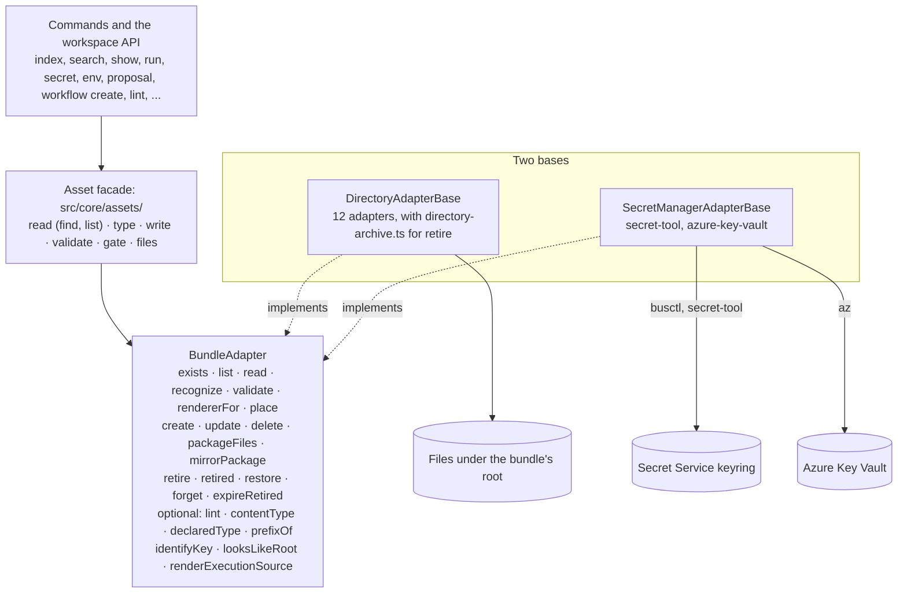

# Adapters

A **`BundleAdapter`** (`src/core/adapter/bundle-adapter.ts`) is the layer
through which the rest of akm works with a bundle's assets, whatever keeps
them. The adapter owns the mechanics of its bundles: how assets are listed,
read, described for the index, placed, created, updated, deleted and
retired, and how `akm lint` validates them. Code outside the adapter layer
works with assets through one facade, `src/core/assets/`, and does not ask
which adapter holds an asset, where, or under what file name.

akm ships 14 built-in adapters: 12 read a directory, one per format in
[Supported Formats](../reference/supported-formats.md), and 2 read a secret
manager (an OS keyring, an Azure Key Vault). This page is the internals
reference; that page is the compatibility table.

For read-only native tool bundles, recognition is runtime translation, not
conversion: the adapter projects native files into AKM's index/runtime shapes
while the source file remains authoritative. AKM does not synchronize native
formats, maintain translated canonical copies, or write agent/command assets
back through the Claude/OpenCode adapters. Execution of agent and command assets
is described in [Architecture: Connections and Harnesses](architecture.md#connections-and-harnesses).

> **Stability note.** The adapter set, bundle-recognition rules, and the
> `bundles` config shape are still evolving — see [STABILITY.md](../../STABILITY.md).

> **Migration nearly finished.** [Principled exceptions](#principled-exceptions)
> lists what stays outside the facade for good. Seven reads still done as the
> base release did them carry `// asset-io: base`, each with its reason; see
> [The seven `base` exemptions](#the-seven-base-exemptions).

---

## Architecture



A bundle's config entry says where it is (`path`, `git`, `website`, `npm`, or
`location` for a bundle that is not a directory) and which adapter reads it
(`adapter`). The facade (`AssetBundle`, `src/core/assets/bundle.ts`) turns the
entry into the adapter and a `Bundle` (`bundleOf`, `src/core/adapter/registry.ts`)
and calls the adapter with it. It holds the adapter privately, so nothing
outside the facade calls an adapter member except through the gates the facade
puts in front of it.

---

## The contract

From `src/core/adapter/bundle-adapter.ts` and `src/core/adapter/types.ts`:

```ts
/** A bundle as its adapter is handed it. */
interface Bundle {
  id: string;        // the config name; the prefix of every ref its assets have
  root?: string;     // directory bundles only: the absolute content root
  location?: string; // location bundles: the keyring's or vault's name
}

/** One asset as its adapter holds it. */
interface AssetEntry {
  readonly key: string;       // the adapter's storage key (directory: POSIX path inside the root; store: `secrets/<name>`)
  readonly file?: string;     // the file that holds it, for display and handing to a program; absent when no file does
  readonly locator?: unknown; // what finds it again in its storage; the index records it, only the adapter reads it
  modified?(): Date;          // when it last changed, when the adapter knows; callers never stat `file`
  mode?(): number;            // the permission bits of the file that holds it, when one does
  content(): string;          // read once, when asked
  bytes(): Buffer;
  frontmatter(): Record<string, unknown> | null;
}

/** One asset per concept; `findings`: what is wrong with a store's entries, which `akm index` records. */
interface BundleListing { assets: BundleAsset[]; complete: boolean; incompleteReason?: string; findings?: Diagnostic[] }

interface BundleAdapter {
  readonly id: string;
  readonly version: string;                    // index freshness and fingerprints
  readonly addressedBy: "root" | "location";   // how config names its bundles
  readonly writes: readonly string[];          // types it creates, updates, deletes; empty: read-only
  readonly retires: readonly string[];         // subset of writes it retires recoverably; never env or secret

  exists(b: Bundle): boolean;                  // storage is there; reads no asset, never prompts
  list(b: Bundle, type?: string): BundleListing; // one asset per concept; assets only; reads no content
  read(b: Bundle, conceptId: string, locator?: unknown): BundleAsset | undefined; // any spelling in, canonical id out
  recognize(b: Bundle, entry: AssetEntry): IndexDocument | null; // the only producer of a type
  validate(b: Bundle, edits: AssetEdit[], ctx: ValidateContext): Promise<Diagnostic[]>;
  rendererFor(type: string): string | undefined; // how `akm show` renders a type it does not present; undefined: match the entry live

  place(b: Bundle, asset: { type; name }): AssetPlacement;       // where a create would go: its concept id, and for files the key
  create(b: Bundle, asset: NewAsset,
    options?: { replace?: boolean; verbatim?: boolean; locator?: unknown }): AssetChange;
  update(b: Bundle, conceptId: string, content: string | Buffer,
    options?: { locator?: unknown }): AssetChange;
  delete(b: Bundle, conceptId: string, options?: { locator?: unknown }): AssetChange[]; // one per asset
  retire(b: Bundle, conceptId: string, note: RetireNote): Array<AssetChange & { handle: string }>; // one per asset
  packageFiles(b: Bundle, conceptId: string): PackageFile[];     // every file under a package entry's folder
  mirrorPackage(b: Bundle, asset: { type; name }, files: readonly PackageFile[],
    options?: { replace?: boolean }): AssetChange[];             // one per asset added, changed or removed
  retired(b: Bundle): Retirement[];
  restore(b: Bundle, handle: string, fallback?: string | Buffer): AssetChange;
  forget(b: Bundle, handle: string): { changed: string[] };
  expireRetired(b: Bundle, before: Date): { changed: string[] };

  // Optional.
  lint?(run: LintRun): Promise<LintFindings>;  // `akm lint` of the bundle or of one file; absent: `validate` plus the cross-bundle `.env` sweep
  renderExecutionSource?(b: Bundle, entry: AssetEntry): AdapterRenderedExecutionSource | null;
  looksLikeRoot?(root: string): boolean;       // install-time probe only
  contentType?(b: Bundle, entry: AssetEntry): string | undefined;      // the type the bytes give, without describing
  declaredType?(key: string): string | undefined;                      // the type a key's folder declares (`memories/`)
  prefixOf?(type: string): string;                                     // what a create puts before a name in the concept id (`tasks/`)
  identifyKey?(b: Bundle, key: string): string | null;                 // converters of old stored records only
}
```

An adapter never reads the index. For a store, the facade looks up the `locator` the index recorded for an entry and
hands it to `read` and to a replacing `create`, `update` and `delete`, and adds the `findings` the last `akm index`
recorded to what `validate` returns.

An asset is addressed by its **concept id**: its ref without the bundle.
`BundleAsset` is `{ conceptId, entry }`. A write returns an `AssetChange`: the
concept id, the asset's file when it has one, the files the write changed (empty
for a bundle that is not a directory) for the bundle's commit boundary, and the
content the asset now holds.

`findings` are what is wrong with a store's entries (invalid or shared names),
which `akm index` records and `akm lint` reads back. `complete: false`
means part of the bundle could not be read: the indexer keeps the rows it had
and the run warns. With `type`, `complete` speaks only for the part of the
bundle that holds that type. A store that cannot be reached at all is not a
listing: `list` throws `BUNDLE_UNREACHABLE`.

Every member not marked optional is required. A base class implements the
members its adapters do not support by refusing. Both bases answer `rendererFor`
with the type's own renderer; `akm` answers undefined (its assets are matched
live) and `akm-workflow` the workflow renderer. `writes` is per type because
"a secret is deleted, never archived" is a fact about a type, which the adapter
owns. `create` writes the adapter's own form of the type, or with `verbatim`
exactly `asset.content` (a proposal's reviewed bytes); over an existing concept
it is refused unless `replace`. `packageFiles` and `mirrorPackage` are refused
by an adapter that keeps no packages (see [Packages](#packages)).

`Diagnostic` is `{ ref, file?, issue, detail, fixed, line? }`: `ref` names the
asset, and `file` is the file to show for it when there is one.

---

## Identity

A concept id is a pure function of the storage key, and a ref
(`<bundle>//<conceptId>`) names exactly one asset for every caller.

- `identify(key)` (a directory adapter's hook, below) gets no bundle, no file
  system and no content. So `list`, `read`, `place` and the retired-asset id
  cannot read a file.
- `read` accepts any spelling its adapter allows (`knowledge/guide.md`, a case
  variant such as `guide.MD`, the file name of a task) and returns the
  canonical concept id.
- Only `Asset.ref` is ever persisted.

### The winner rule

A concept can be spelled by several files in one bundle (`tasks/x.yml` and
`tasks/x.md`, `skills/x.md` and `skills/x/SKILL.md`, `guide.md` and
`guide.MD`). The adapter chooses one winner from paths alone, the same for
every caller, with no read of any file.

In `DirectoryAdapterBase` the one function that decides it is `holders()`. The
winner is the first spelling, in `spellings(conceptId)` order, that:

1. exists as a file inside the root;
2. a full walk of the bundle reaches; and
3. `identify` maps back to the concept.

An exact spelling ranks before its case variants, which are ordered by code
point. `list` picks the same file per concept (`compareSpellings`). When the
asker names a file (`tasks/dup.md`) rather than a concept id, the first existing
spelling's file holds some concept, and that concept's winner is the answer: a
file name never reaches a file that the concept's own spelling order ranks below
another.

Spelling orders: akm puts the file its folder's type places first
(`tasks/x.yml` before `tasks/x.md`), then placement-type order; generic-files
`x`, `.md`, `.markdown`, `.txt`, `.text`; akm-task `.yml` before `.yaml`.

The ignored spellings are reported by `validate` as `shadowed-spelling`, which
names the winner (shown by `akm lint`). There is no runtime warning and no
refusal.

**A file the walk does not reach is not an asset.** Dot-directories, `bin/`,
`.cache/`, `node_modules` and git-ignored files (outside `env/` and `secrets/`)
are in no bundle: `read` returns nothing for them, for every command.

A replacing `create` of an existing concept writes the winner's file
(`memories/mm.MD`), never a twin beside it.

### Outdated type-folder spelling

Earlier releases prefixed a loose file's ref with its type folder
(`knowledge/reports/x` for `reports/x.md`). `qualifyRef` (`src/core/assets/read.ts`),
where an input ref is qualified, retries a ref nothing holds once more without
that head and warns once with the current ref. The spelling is akm's, not a
format's, so no adapter has a hook for it. A stored ref is read without the
warning.

---

## Directory adapters

`DirectoryAdapterBase` (`src/core/adapter/directory-adapter.ts`) implements every
member once, as template methods. A subclass supplies its format through hooks
and does not override the template methods.

| Hook | Default | Supplied by |
| --- | --- | --- |
| `identify(relPath): string \| null` | | every subclass; path only |
| `spellings(conceptId): string[]` | | every subclass; the winner first |
| `describe(b, file, conceptId)` | | every subclass; the index metadata; may read content |
| `validateFiles(b, changes, ctx)` | | every subclass; the format's own checks |
| `placeFile(b, { type, name })` | refuses | `AkmFormatAdapterBase`, akm-workflow |
| `serialize(type, file, content)` | as given | `AkmFormatAdapterBase` |
| `fileMode(type)` | an existing file keeps its mode | `AkmFormatAdapterBase` (0600 for env and secret) |
| `typeOf(relPath)` | refuses | `AkmFormatAdapterBase`; the path rule the write gates use |
| `packageDir(file)` | none | akm, agent-skills, claude, opencode: a skill's folder |
| `typeFolder(type)` | none: anywhere | `AkmFormatAdapterBase`: the folder that holds a type's assets |
| `walkMode` | `"akm"` | okf and code-project use `"all-directories"` |
| `directoryList(b)` | `[]` | the folders the adapter owns: git exact-path staging |

The template methods:

- `list` walks the bundle (`walkStashFlatWithStatus`) with the adapter's
  `walkMode` and returns one asset per concept: the winner. The `"akm"` walk
  skips dot-directories, `bin/` and `.cache/` and lists git-ignored `env/` and
  `secrets/` files; `"all-directories"` lists every directory except `.git` and
  `node_modules`.
- `read` is `holders()` (above). It is existence checks and directory reads
  only: no content.
- `recognize` returns `describe`'s metadata, then sets the identity `identify`
  gives (`ref`, `bundle`, `conceptId`, `adapterId`, `path`) last, so `describe`
  cannot change it. `IndexDocument.hash` equals `hashContent(entry.content())` for
  every directory adapter.
- `validate` turns the edits into file changes over the bundle's snapshot, runs
  `validateFiles`, and adds a `shadowed-spelling` finding for each concept more
  than one file spells.
- `place` returns where a create would go (the concept id, the storage key,
  whether something is kept there now, and the file to show), and refuses with a
  `UsageError` naming the file when the placed file would be no asset
  (`create knowledge "index"`, `create secret "x.lock"`).
- `create` and `update` write atomically (`writeFileAtomic`) and refuse a path
  that leaves the bundle's root. They follow a symbolic link below it only when
  the link leads to an existing file or folder inside the bundle; any other link
  refuses the write. A create replaces such a link with a regular file, an update
  writes where it leads and keeps it, and a hard link is a regular file. `delete`
  removes a symbolic link itself, never its target, whether the link stays inside
  the bundle, leaves it or dangles. `retire` and `restore` are the documented
  exceptions to the shared link rule (`assertWritableFile`): they refuse every
  symbolic link because moving a relative link into the archive would leave it
  dangling. `place` is checked first, and an adapter whose `writes` lacks the
  type refuses as an invariant error a user never sees: the facade checks
  `writes` before it calls.
- `retire`, `retired`, `restore`, `forget` and `expireRetired` delegate to
  `directory-archive.ts` (see [Retire and delete](#retire-and-delete)).

`spellings` preserve canonical directory manifests (for example
`skills/<name>/SKILL.md`) so lookup, index-backed show and workflow runtime
share one decision about which file owns a concept.

### Format bases

- `AkmFormatAdapterBase` (`adapters/akm-format.ts`): `akm`, `dotenv`,
  `akm-workflow`. It places each type in its folder by the placement spec
  (`placeInTypeFolder`), serializes the type's form, gives env and secret files
  mode 0600, and sets `retires` to `writes` minus `env` and `secret`.
- `ToolDirAdapterBase` (`adapters/tool-dir-shared.ts`): `claude`, `opencode`.
  One codec, read-only.
- Direct and read-only: `agent-skills`, `akm-task`, `llm-wiki`, `okf`,
  `generic-files`, `code-project`, `website-snapshot`.

---

## Adapters of a secret manager

`SecretManagerAdapterBase` (`src/core/adapter/secret-manager-adapter.ts`)
implements the contract once for `secret-tool` and `azure-key-vault`; a subclass
supplies four primitives (`locate`, `listSecrets`, `storeSecret`,
`deleteSecret`) and two optional ones (`findSecret`, `requireStorable`).

A bundle of this kind is addressed by `location` (`addressedBy: "location"`) and
holds secrets only, as the concept ids `secrets/<name>`: the ref a secret file
has in a directory bundle, so the rest of akm does not tell them apart. Its
entries have no `file`, and its index documents have no `path`. `writes` is
`["secret"]`, `retires` is empty, `retired()` is `[]`, and the other retire
members refuse. A bundle names the adapter in `adapter` and the keyring or vault
in `location`:

```json
"keyring": { "adapter": "secret-tool", "location": "akm" },
"vault": { "adapter": "azure-key-vault", "location": "team-vault" }
```

Rules the base applies:

- `recognize` reads no value: the type is `secret`, the name is the last path
  segment, and the hash is of the key, never the value.
- A name that does not read back as the ref `secrets/<name>` is not an asset:
  `list` and `read` skip it, and `list` returns it in `findings`
  (`invalid-name`).
- Items sharing a name: the lowest `id` by code point wins. `read`, `update`
  and `delete` act on the winner; `list` returns the others in `findings` as
  `shadowed-spelling`.
- `validate` checks nothing live: `akm lint` never lists the store. The facade
  adds the `findings` the last `akm index` recorded.
- The metadata lives in the index: `akm index` lists the store and records each
  entry, with its `locator`. `akm secret list` reads the index. At run time akm
  asks the store only for a value, a write, or a delete, through the recorded
  `locator`.
- A store that cannot be reached (client missing, no session, keyring or vault
  not there, account refused) is `BUNDLE_UNREACHABLE`, thrown by `list`. Any
  other failure is a plain error naming the operation. `akm index` warns of a
  store it cannot list and keeps the rows it had; the facade catches it only
  for a typed listing of a type the bundle cannot hold.
- What the base read of a store lives for one command: `list` reads the store
  once, and a write drops it. The CLI (per command) and Desktop (per request)
  call `clearAdapterCaches()`.
- Listing needs no unlock. A read, store or delete in a locked keyring unlocks
  it through the keyring manager's own prompt, which `secret-tool` shows, in
  every command and host.
- Values reach a client on its standard input or in a file only the user can
  read, never in an argument.

What each adapter does with the primitives:

| | `secret-tool` | `azure-key-vault` |
| --- | --- | --- |
| Finds the store | the alias `location`, else the collection labelled `location`, else `/org/freedesktop/secrets/collection/<location>`; resolved once to one object path | the vault named `location` |
| `list` | the collection's entries over `busctl` (label, object path and attributes, never a value), without unlocking it | `az keyvault secret list` of the enabled, unmanaged secrets |
| `read` | the entry the recorded `locator` names: one `SearchItems` of its attribute pairs (it must be the only match), then its value with `secret-tool lookup` when `content()` is asked | one `az keyvault secret show`; its value when `content()` is asked |
| `create` / `update` | `secret-tool store` into the collection's object path, value on stdin, with the entry's recorded attributes; a new entry gets the one pair `akm <keyring>/<name>`, which `secret-tool store` requires and nothing reads | `az keyvault secret set --file`, a temporary file only the user can read |
| `delete` | `Delete` on the entry's recorded object path (`secret-tool clear` would delete every match) | `az keyvault secret delete`, then `purge` |

The user-facing rules (lookup order, unlock, naming, purge, required tools) are
in [Environment and secrets](../reference/env-and-secrets.md#secrets-kept-by-a-secret-manager).

---

## Registry

`src/core/adapter/registry.ts` is the one list of adapter ids.
`BUILTIN_ADAPTERS` (`src/core/adapter/adapters/index.ts`) is a frozen, ordered
array; the order is the install-time probe order. The registry exposes
`getAdapters()`, `adapterForId()`, `adapterIds()`, `requireAdapter(bundle, id,
address?)`, `bundleOf(source)` and `clearAdapterCaches()`.

`requireAdapter` is the check where a bundle is resolved. It refuses, with a
`ConfigError` (`INVALID_CONFIG_FILE`):

- an id akm does not have, naming the valid ids;
- an adapter addressed by `location` for a bundle without one;
- an adapter addressed by `root` for a bundle that has a `location`.

Adding an adapter is one class file, one line in `BUILTIN_ADAPTERS`, and its
rows in the docs.

A bundle's adapter is the one its config entry names (`adapter`), recorded when
the bundle is added. A bundle without one (an older config entry, the implicit
stash, a directory the user names) gets the adapter whose root probe claims it,
once, where the bundle is resolved (`detectBundleAdapter`,
`src/core/assets/gate.ts`). An asset read or write never probes.

---

## The facade: `src/core/assets/`

| Module | What it is for |
| --- | --- |
| `read.ts` | `qualifyRef`, `lookupAsset`, `findAsset`, `requireAsset`, `readAsset`, `listAssets`, `packageFilesAt`, `currentConceptId`, `assetRevision` |
| `type.ts` | `assetType`, `assetTypes`, `assetTypeFresh`, `typeOfContent`, `recognizeContent`, `presentationOf`, `indexAsset`, `embedPendingWrites` |
| `write.ts` | `writeAssets`, `addressOf`, `fileOfRef`, `legacyRefOf` |
| `validate.ts` | `validateBundleAssets`: `akm lint`'s scan of a bundle; `storeFindings`: what the configured keyrings and vaults report (a bundle kept in files has none) |
| `gate.ts` | what callers decide before they write or configure, asked of a bundle (its id or its source record), never of an adapter id a caller computed: `assertAdapterWrites`, `adapterWrites`, `refuseByAdapter`, `adapterNameOf` (for a message), `adapterAddressedBy`, `detectBundleAdapter`, `lintBundle` (`akm lint` of a bundle by its adapter), `bundleStorageExists`, `clearAdapterCaches`; and `renderIndexedExecutionSource`, which renders a command or persona for `akm run` by the adapter its index row records |
| `files.ts` | `indexFiles`: index rows for files akm did not write through the facade (the Desktop Files view); and, re-exported under `files-view`, the path rules and the plain-file write check the Files view uses |
| `bundle.ts`, `asset.ts`, `index-rows.ts` | internal: `AssetBundle` (holds its adapter), `Asset`, and the index rows the facade records |

The facade re-exports no adapter module but the contract (`facade-reexport`).
Code that needs an adapter module's internals imports it itself, under an
exemption the lint counts: the base checks read what a bundle keeps at a ref's
spelling (`directory/held-files`) under `base`, as do the execution loader
(`directory/file-context`) and
`akm health`'s archive size (`directory-archive`). `akm doctor` and `akm bundle
add` import the adapter-skip report (`adapter-skips`), which the lint lists as
importable.

An **`Asset`** is `{ bundle, conceptId, ref, entry }`: its identity and the
entry that holds it. It carries no root.

### Find and list

`qualifyRef(input, from?)` qualifies an input ref once, where it enters: a ref
that names no bundle gets the first bundle whose adapter holds it, `from`'s
bundle first (a ref inside content), then the default bundle, then the
configured order. `findAsset(ref)` and `requireAsset(ref)` (a `NotFoundError`,
`ASSET_NOT_FOUND`) take a qualified ref and consider its own bundle only; a
stored ref with no bundle (an older record) is found in the first bundle that
holds it. `lookupAsset` is `qualifyRef` and `findAsset` in one read. `listAssets({ bundle?, type? })` returns one asset per concept
as each bundle's adapter lists it, in bundle order and then by concept id.

Find and list are synchronous and read no content and no index. `listAssets`
with `type` is the one that asks the index, because a type is index metadata.
A bundle listed incompletely is warned about, naming it. A bundle that cannot be
reached fails the listing with `BUNDLE_UNREACHABLE` when it holds what was asked
for (every listing, or a type its adapter writes).

### Type comes from the index

A type is index metadata: only the adapter's `recognize` gives it, the index
records it, and every read of a type comes from the index (`assetType`,
`assetTypes`, `listAssets({ type })`, a row's `type`). Finding and listing say
where an asset is, never what it is.

- `assetType(asset)` reads the row for `asset.ref`. An asset with no row, or a
  row an older adapter version described (the row's directory records an
  `index_variant` that is not the adapter's `<id>@<version>+`), is indexed first:
  one `recognize`, one upsert, under the index-writer lock without waiting. If
  the lock is held or the index cannot be written, the type is `recognize`'s for
  that call.
- A row is refreshed by `akm index` and by akm's own writes. A file edited
  outside akm is seen by the next `akm index`.

Two facade calls are the exceptions, for a caller that already holds the
bytes:

- `assetTypeFresh(asset)`: for a gate that runs, renders or clones a saved
  asset. It hashes `entry.content()` and compares the row's `content_hash`;
  only on a difference does it describe the asset again before it answers. An
  asset no file holds is typed by its row. The `run` gate
  (`commands/run-cli.ts`) and the clone's type check
  (`commands/sources/source-clone.ts`) use it.
- `typeOfContent(bundle, key, content)`: for text a caller holds but has not
  saved (`src/workspace/check-text.ts`). The adapter types `content` as stored
  under `key`; nothing is read or written.

Write gates (`writes`, `retires`, `fileMode`, `serialize`) use the row or the
adapter's path rule `typeOf(key)`. This is safe because every type an adapter
can derive from content for one path has the same `writes` and `retires`
membership, file mode and serialization as the path type.

### Write

`writeAssets(target, { purpose, message? }, (w) => …)` runs a session against a
write target's bundle under the asset-mutation lease (re-entrant). The writer
`w` has `read`, `address`, `create`, `update`, `delete`, `mirrorPackage`,
`retire`, `retired`, `restore`, `forget` and `expireRetired`. `addressOf(source, ref)` says where a
write to a ref goes without a session.

Every change passes the same gates, in this order, whichever adapter holds the
bundle:

1. `ensureWritable`: the bundle's `writable` setting.
2. The type is in the adapter's `writes` (a create: the stated type; any other
   change: `assetType` of the existing asset). A retire also needs the type in
   `retires`. `restore`, `forget` and `expireRetired` need an adapter that
   retires some type.
3. For a create with `exclusive`: the placed concept must not exist
   (`RESOURCE_ALREADY_EXISTS`). Without `exclusive` a create replaces the
   asset: the adapter's `create` runs with `replace`.
4. For a change with `revision`: the SHA-256 of the existing asset's bytes must
   match (`ASSET_CONTENT_CHANGED`).

The refusals of step 2 are the facade's, held once in `AssetBundle`:
`Bundle "<b>" uses adapter "<id>", which does not support AKM asset writes.`
A placement refusal is the adapter's own `UsageError` from `place`, naming the
file, because only the adapter knows its storage.

After each change the facade records the changed files for the target's
boundary commit and for the run's write provenance, and refreshes the changed
asset's index row, or drops it after a delete or retire; callers do not refresh
the index themselves. With `message`, the boundary commit runs when the session
returns.

### Validate

`validateBundleAssets(bundle, { keep?, ctx? })` asks the bundle's adapter to
`validate` every asset it lists, each as an `update`. This is `akm lint`'s scan
of a bundle as it stands.

### Lint

`akm lint` has one pipeline. It asks the bundle's adapter for `lint(run)`
(`lintBundle` in `gate.ts`), then adds the tracked-secret and store findings and
applies `lint.skip` and `--rule`. An adapter without a `lint` is checked by its
`validate` plus the cross-bundle `.env` sweep (`adapters/akm-lint-run.ts`); `okf`
returns its `validate` alone. The `akm` adapter's `lint` is the sweep of its
document folders (`adapters/akm-sweep.ts`): each file's base and per-type checks,
the skill folders, the task files (the `.yaml` near-miss included) and the
workflow frontend, with what its own `validate` adds. `validate` never writes: a
fix (`--fix`, `--fix-moved-refs`, `--prune-dangling-edges`) is an asset write the
sweep makes through `writeAssets`, one session per change. `akm lint <file>`
passes `run.file`, and the adapter reports that file only; a file outside every
bundle is read as the akm document type `--type` names. Callers never ask which
adapter a bundle has, or whether its folders declare types
(`tests/integration/lint-parity.test.ts` pins the output).

---

## Retire and delete

An adapter's `writes` says what it creates, updates and deletes. Its `retires`
says which of those types it takes out recoverably.

- **Delete** removes the asset. The directory adapters remove the file; for a
  symbolic link they remove the link itself and never its target.
- **Retire** keeps the asset and a record of why. `akm` retires every type it
  writes except `env` and `secret`; `akm-workflow` retires `workflow`; `dotenv`
  and the secret managers retire nothing.
- **An env file or a secret is deleted, never retired**: nothing recoverable
  should keep its value. `env remove` and `secret remove` delete.

`directory-archive.ts` is the archive of a directory bundle:

- `retire` writes the tombstone `cleanup.md` first, then renames the file to
  `.akm/memory-cleanup/archive/<archivedAt>-<concept id>[-n]/<originalPath>`. A
  crash between the two leaves a tombstone for a move that did not happen, and
  the file where it was; a resumed `proposal accept` counts a retirement only
  once its asset is gone, so it forgets such a tombstone and retires the asset
  again.
- A retirement's `handle` is its archive directory relative to the root. It is
  opaque to callers: never parsed, joined or treated as a path; output may print
  it as a string.
- The tombstone's ref-valued note fields (`ref`, `parentRef`, `survivorRef`,
  `successorRefs`) and the directory name hold concept ids: a ref into the
  bundle is written without its `bundle//`, another bundle's stays qualified.
  `retired()` returns the refs qualified; a tombstone an older akm wrote with
  qualified refs is read as written.
- `restore` refuses when both the original and the archived file exist, renames
  back, writes `fallback` when the archived content is gone (and refuses without
  one), and does nothing when already restored. It keeps the tombstone, so a
  caller can record its decision before `forget` removes it: restoring twice is
  a no-op, which makes a revert crash-resumable.
- `expireRetired(before)` deletes archived content older than `before` in
  git-backed bundles only, and only when git says the files are tracked and
  clean. `retiredAt` in the note is caller-set; its presence makes a retirement
  expirable.

---

## Packages

A package is a folder that an entry file names: a skill's `SKILL.md` and the
files beside it. `packageDir(file)` says which adapters have them: `akm`,
`agent-skills`, `claude` and `opencode` (a skill's folder).

Every file under a package folder (`skills/x/references/a.md`) is its own
asset with its own ref. `packageFiles` returns every file under a package
entry's folder, non-asset files included, with its bytes and mode.
`mirrorPackage` makes a package an exact mirror of such a list (`akm clone` of
a skill): it writes the folder staged beside the target and renamed into place,
so a failed write leaves the old package as it was.

`retire` of a package entry retires every asset under its folder, each its own
retirement with its own handle (the entry's comes first), and leaves the
folder's files that are no asset where they are; restoring each handle brings
the package back. `delete` of a package entry removes its folder, non-asset
files included, with one change per asset it held, so every one of their index
rows goes.

---

## Principled exceptions

These stay outside the facade for good. Each carries a reason in the lint
(`// asset-io: <reason>`).

1. **`entry.file`** is for display and for handing to a program (a script run,
   `${ref}` path tokens, `env path`, runners, harness launch). It is never
   persisted, compared, or used to find the asset again. A file-less asset (a
   keyring or vault secret) refuses with one sentence: `"<ref>" is not kept in a
   file, so it has no path.` Reasons `display` and `exec`.
2. **The Desktop Files view** (`workspace/file-actions.ts`, `copy-entry.ts`,
   `bundle-files.ts`, `git-read.ts`, `core/trash.ts`, plain-file writes in
   `write-source.ts`, and the Desktop server's file features): a file manager
   over a directory bundle's tree, offered only for bundles with a root. It edits
   storage like an editor or `git pull` and writes no state of its own. Reason
   `files-view`.
3. **A directory the user names** (`--dir`, `bundle add <path>`,
   `AKM_BUNDLE_DIR`, `akm init --dir`) is mapped to a bundle by one lookup
   (`bundleAtDir`, `src/core/bundle-at-dir.ts`); the state converter that turns
   a stored root into a bundle id is the other. Reason `user-input`.
4. **Non-asset files** akm owns or the user names: config, state, installs,
   scratch, shipped templates, host files, disk-usage measurement, `.meta/`
   documents. Reasons `config`, `state`, `install`, `scratch`, `shipped`, `host`,
   `disk-usage`, `bundle-meta`, `bundle-root`.
5. **Install-time detection**: `looksLikeRoot` runs when a bundle is added, and
   once where a bundle without `adapter` is resolved; never for an asset read or
   write.
6. **The directory scan's incremental state** (`index_dir_state`) is the
   indexer's private derived state for directory bundles.
7. **Workflow code** (deprecated, removed in 0.11): keeps its own file access
   with the reason `deprecated`.

### The seven `base` exemptions

Each stays because the facade cannot give the read without a change the owner has
not approved. Measured on a generated bundle of 2,400 assets in a git repository
(Bun, this machine): stat of every row's file 7 ms, existence of every file 4.6 ms,
one facade listing of the bundle 72 ms, one facade find per row 5.8 ms (about 14 s
at 2,400 rows, from its `git check-ignore` process).

| File | Read | Why it stays |
| --- | --- | --- |
| `workspace/graph.ts` | mtime of each indexed file | the facade has no mtime and may not stat (`facade-fs`); a listing is 10x the stats, a find per row far more |
| `commands/improve/retrieval-scope.ts` | mtime of a candidate's file | same |
| `commands/read/related.ts` | whether a neighbour's indexed file exists | no existence read for a row's file; a listing costs far more than stats of a few candidates |
| `commands/read/show.ts` | a script file no adapter lists, shown as plain text | the facade reads through adapters, and none lists it |
| `commands/command/execution-source-loader.ts` | the file an index row names, read as its row's adapter indexed it | rows can share a ref, so the facade's winner for the ref can be another file; the facade may not build a file context |
| `commands/health/archive-usage.ts` | size of the folder a directory bundle keeps retirements in | health measures the folder, not the retirements `retired()` lists |
| `commands/lint/base-linter.ts` | what a bundle keeps at a ref's spelling, a file no adapter lists included | missing-ref counts files no adapter lists |

Moving the first three needs a member on the adapter contract (a stat or a batched
existence read), which this change does not add. `indexer/path-resolver.ts`'s
`entry.file` read moved behind `indexedPathOf`.

---

## Enforcement

`scripts/lint-asset-io.ts` runs in `bun run lint`. Over `src/` and
`desktop/src/lib/server/` it checks thirteen rules, outside `src/core/adapter/`
and `src/core/assets/` unless the rule says otherwise:

| Rule | Flags |
| --- | --- |
| `asset-io` | a call that reads, writes, stats or walks files, or asks the registry for an adapter |
| `adapter-import` | an import from `src/core/adapter/**` other than `bundle-adapter`, `types` and `adapter-skips`, the walk (`directory/`) included |
| `facade-internal` | an import of `src/core/assets/bundle`, `asset` or `index-rows` |
| `adapter-id` | a registry id compared with anything, `kind === "location"`, or `.fileless` |
| `entry-file` | `entry.file`: a path is for display or for a program, never for finding an asset |
| `adapter-probe` | a call of `detectAdapterId` or `adapterIdOf` |
| `facade-export` | an export of a public facade module that nothing outside the facade imports |
| `facade-fs` | inside `src/core/assets/`: a file-access call; the facade reaches storage through adapters only |
| `facade-adapter-id` | inside `src/core/assets/`: what `adapter-id` flags; adapter-specific behaviour is a contract member |
| `facade-reexport` | in a public facade module: an `export ... from` an adapter module other than the contract; only `files-view` exempts it |
| `store-sniff` | a test of whether a bundle is a store: `.isStore`, `addressedBy`, or `.location` compared |
| `entries-sql` | raw SQL on the `entries` table or `index_meta` outside `src/storage/`, `src/core/assets/` and `src/indexer/` |
| `entry-file-logic` | `entry.file` compared (a test against `undefined` excepted) or used as a map or set key |

A line may carry `// asset-io: <reason>` for access that is not an asset; the
reasons and what each covers are in `REASONS` in the script. Any violation
fails the check; there is no baseline.

---

## Capabilities

Read from `BUILTIN_ADAPTERS`. "Probe" is whether `looksLikeRoot` can claim a
root; the order of the rows is the probe order.

| Adapter | Addressed by | `writes` | `retires` | Package folder | Walk | Renders agents and commands | Probe |
| --- | --- | --- | --- | --- | --- | --- | --- |
| `website-snapshot` | root | none | none | no | akm | no | yes |
| `agent-skills` | root | none | none | skill | akm | no | yes |
| `claude` | root | none | none | skill | akm | yes | yes |
| `opencode` | root | none | none | skill | akm | yes | yes |
| `dotenv` | root | `env`, `secret` | none | no | akm | no | yes |
| `akm-workflow` | root | `workflow` | `workflow` | no | akm | no | yes |
| `akm-task` | root | none | none | no | akm | no | yes |
| `llm-wiki` | root | none | none | no | akm | no | yes |
| `akm` | root | every placement type (15) | all of them but `env` and `secret` | skill | akm | yes | yes |
| `okf` | root | none | none | no | all directories | no | yes |
| `generic-files` | root | none | none | no | akm | no | never fires |
| `code-project` | root | none | none | no | all directories | no | none |
| `secret-tool` | location | `secret` | none | no | none | no | none |
| `azure-key-vault` | location | `secret` | none | no | none | no | none |

---

## Probe order

Each bundle root is owned by exactly **one** adapter:

1. If the bundle's config entry sets `adapter` explicitly, that adapter wins:
   no detection runs.
2. Otherwise, every built-in adapter's `looksLikeRoot(root)` probe runs in a
   **fixed order**, most-specific markers first. The first probe that
   returns `true` claims the root.
3. If no probe fires, the bundle falls back to the `akm` adapter.

The order is the array order of `BUILTIN_ADAPTERS`
(`src/core/adapter/adapters/index.ts`), pinned by
`tests/core/adapter/registry.test.ts`:

```text
website-snapshot   -- root manifest.json {url, fetchedAt}
agent-skills       -- a <name>/SKILL.md package at the bundle root
claude             -- root CLAUDE.md + commands/|agents/|skills/
opencode           -- opencode.json(c), or root AGENTS.md + a tool dir
dotenv             -- every top-level dir is env/ and/or secrets/
akm-workflow       -- a top-level .md with explicit type: workflow
akm-task           -- a top-level task source .yml (v4 or v5, or a v2/v3 file awaiting migration)
llm-wiki           -- root schema.md + pages/
akm                -- .stash marker, or 2+ native subdirs, or fallback
okf                -- root index.md, or any .md with frontmatter type
generic-files      -- never auto-selected; explicit config only
code-project       -- never auto-selected; explicit config only
secret-tool        -- no probe; a location bundle's configured adapter
azure-key-vault    -- no probe; a location bundle's configured adapter
```

The rationale for the ordering:

- The three loosest probes — `llm-wiki`, `akm`, and `okf` — stay **last**.
  Native AKM evidence wins before OKF because AKM Markdown is an OKF
  superset; the `akm` probe is strict enough not to claim an OKF bundle
  merely because it contains one familiar directory name.
- `akm.looksLikeRoot` fires on any root carrying a bundle-subdir-named
  directory — which includes a `.claude`/`.opencode` tool dir (`commands/`,
  `agents/`, `skills/`) and a dotenv bundle (`env/`, `secrets/`). So
  `claude`/`opencode`/`dotenv` come **ahead of** `akm`; their tighter markers
  claim those roots first, and `akm` still wins its own workspace root
  (which those tighter probes reject).
- `website-snapshot`, `agent-skills`, `akm-workflow`, and `akm-task` carry
  disjoint, specific markers that fire on none of the other roots, so they
  sit at the front for clarity.
- `generic-files` is explicit-config-only — its `looksLikeRoot` never fires —
  so it's last and can never shadow anything.

---

## Types per adapter

The type of an asset comes from `describe`, through `recognize`:

- `akm`: folder rules, `SKILL.md`, script extensions, and for a loose `.md` the
  content rules (`$ARGUMENTS`, `agent:`, `model:`, a frontmatter `type:`). Only
  `describe` (at index time) reads content; identity, find and list are path-only.
  akm has no wiki handling: a `wikis/` folder in an akm bundle is ordinary akm
  files.
- `okf`: frontmatter `type` (default `knowledge`).
- `llm-wiki`: `pageKind` (default `note`). A wiki is always its own bundle.
- `akm-workflow`: every non-README `.md` is a workflow; `validate` flags a
  frontmatter `type:` other than `workflow`.
- `website-snapshot`: every `.md` under `stash/knowledge/` is a page.
- Path-derived types: `env`, `secret`, `script`, `skill` and every folder type.

A type depends on the file's own path and content, so the row's content hash
and the adapter `version` cover invalidation: bumping `version` re-types the
adapter's assets at the next `akm index`.

---

## Placement

The adapter places what it creates. akm's formats place each type in its own
folder by the type's placement spec (`placeInTypeFolder`); a standalone workflow
bundle keeps each workflow at its root; a secret manager keeps a secret under its
name. `place(b, asset)` says where a create would go without writing, so
callers can plan (a proposal, `exclusive`).

---

## Writes

Which bundles take an asset write is the adapter's `writes` (see
[Capabilities](#capabilities)). The bundle's `writable` setting is checked as
well. Reading, searching and `akm lint` are unaffected by `writes`. "Read-only"
in [Supported Formats](../reference/supported-formats.md) means an adapter
without `writes`, not a filesystem permission.

Every asset write goes through `writeAssets`: `akm remember` and `akm
import`, `akm clone`, `akm workflow create`, `akm task add`, `akm env create` /
`env remove`, `akm secret set` / `secret remove`, `akm feedback`, `akm lint
--fix`, proposal accept, retire and revert, the `akm improve` passes, `akm
setup`'s tasks, memory inference's child writes, and the workspace's
protected-file operations.

---

## Task adapter

The native and standalone `akm-task` paths delegate to the authoritative task
source parser, `parseTaskSource`, which accepts `version: 4` (task
source v4) and `version: 5-beta.1` (the Experimental task source v5). A task source v4 document declares exactly one executable
selector (`uses` or `run`), but its scheduling is optional — a document with
no `schedule:` is valid and runnable manually. A `version: 3` or `version: 2`
document is not read: it raises `TASK_SCHEMA_VERSION_UNSUPPORTED`, naming
`akm migrate apply`, which converts it. The `akm-task` probe still recognizes a
root of v2/v3 task files so the migrator can find them. Targets are
`akm/command` and canonical `commands/`, `workflows/`, and `scripts/` refs;
the github-action `uses:` variant, agent refs, and task refs are refused.
`.yaml` is a collection hint only: recognition gates on `.yml`, so a `.yaml`
near miss is diagnosed (`invalid-task-yaml`) but never indexed or scheduled.
See [Tasks](../reference/tasks.md) for the public source contract and the
migration path.

---

## Implementation caveats

A few adapter-specific behaviors are easy to assume differently from how
they actually work:

- **`agent-skills` recognition/validation are decoupled.** The per-change
  half of `validate()` only inspects changes that resolve to an actual
  `SKILL.md`, so an invalid skill is still indexed as `skill` (with its raw,
  invalid name projected) and its field violations surface only for files
  that exist. `missing-skill-md` is the exception and runs as a separate
  directory pass: a **top-level** directory that
  holds files but no `SKILL.md` anywhere within three levels is flagged. A
  package's own resource dirs (`pdf-processing/reference/`) are part of the
  item, not candidate packages, and are never considered.
- **The base checks have one implementation.** `unquoted-colon`,
  `missing-updated`, `stale-path`, `missing-ref` and `redacted-content` are
  `runBaseChecks` (`src/core/lint/base-linter.ts`), and `ruleApplies`
  (`src/core/asset/lint-text.ts`) decides whether a rule applies to a file
  (the skill and LLM Wiki exemptions, the bundle's `lint.skip`, an adapter's
  own exclusions). The `akm lint` sweep and every adapter's `validate` call
  them; `createBaseChecker` (`adapters/shared.ts`) is the adapter's way in. It
  reads refs from disk and the settings from `ValidateContext.config` (the run's
  own; it reads the config itself only when the context carries none). The other
  bundles are the sources those settings resolve to, found once per `validate`
  by `DirectoryAdapterBase.validate`; a caller does not pass them. A pending
  change in the context does not satisfy a ref, and it never writes. The per-type checks are one table,
  `perTypeChecks` (`adapters/akm-lint.ts`), keyed by akm type and read by the
  sweep and by `validate`; the one exception is the skill folder check, which
  has a directory walk for the sweep and `skillDirectoryDiagnostics` for
  `validate`. Add a rule or an exemption there, not in an adapter.
  Cross-bundle ref existence is a **core** base check, not an adapter concern.
- **`claude`/`opencode` share one codec** (`tool-dir-shared.ts`) and differ
  only in instruction filename and adapter id. Both accept only
  the canonical plural tool directories.
- **`dotenv` redaction is keyed on the adapter.** A frontmatter `type:` does
  not change it: `env` entries surface only key names and `secret` entries
  surface only the file name. A `.env` file placed under `secrets/` is a secret
  (name-only), not an env group — the directory wins over the `.env` suffix.
- **Task adapters share one task source parser.** A standalone `akm-task`
  bundle and task files owned by the native `akm` adapter both route through
  `parseTaskSource` (see [Task adapter](#task-adapter)).
- **`akm` and `okf` reserve `index.md`/`log.md`** as structural files — never
  indexed as concepts, never valid write targets — at any depth. `llm-wiki`
  reserves `schema.md`, `index.md` and `log.md` only at the wiki root.
- **`okf`'s lenient wording is not a lenient gate.** `missing-type` and
  broken-link findings are labelled `info:`/`warning:` in the diagnostic
  text, but diagnostics carry no severity field: `akm lint` funnels every
  finding into one `flagged` list, and `--fail-on-flagged` fails on any
  non-empty list.
- **`generic-files` is the only adapter with no auto-detection at all.**
  `looksLikeRoot` always returns `false`; a bundle only gets this adapter
  through an explicit `adapter: "generic-files"` override.
- **A location bundle has no directory.** A keyring's or vault's entries are
  index rows with an empty file path, found by ref, and no directory maps to the
  bundle (`bundleAtDir`). Its source has a bundle ID and no path.

---

## See also

- [Supported Formats](../reference/supported-formats.md) — the compatibility table this page's internals back
- [Asset Types](../reference/asset-types.md) — the `akm` adapter's 15 native asset types
- [Concepts](../guides/concepts.md) — the retrieval loop these adapters serve
- [Architecture](architecture.md) — sources, refs, the search pipeline, and the write-source chokepoint
- [Environment and secrets](../reference/env-and-secrets.md) — keyring and Key Vault bundles
